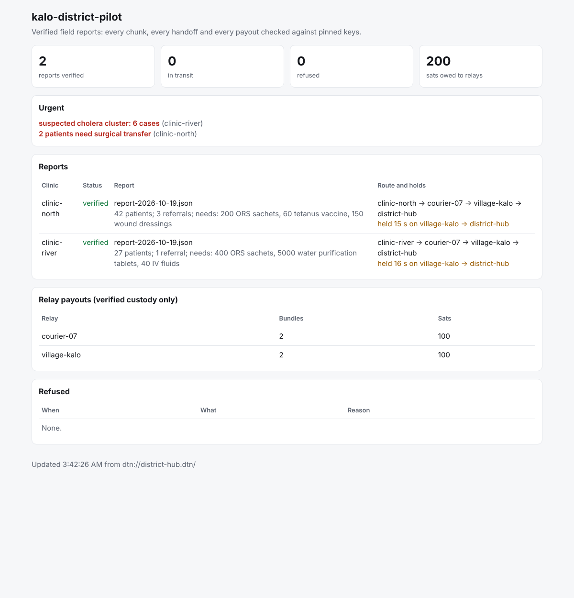

# relief/kit: field pilot kit

Software a relief organization can deploy when the cell network is down: clinic devices send
reports and files to a district hub through couriers and satellite relays, over BPv7 (µD3TN),
and the hub can prove what arrived, that nobody changed it, who carried it, how long it waited,
and who should be paid for carrying it.



*The hub dashboard after a real run over five µD3TN nodes (`run-local.sh`): both clinic reports
verified, both urgent items surfaced, each route and the hold at the village relay shown, and
what each relay is owed. The reports are synthetic.*

## Try it

```bash
# One command (Docker): five nodes, dashboard at http://127.0.0.1:8080/
docker compose -f relief/kit/docker-compose.yml up --build

# Send your own file from a clinic
docker compose -f relief/kit/docker-compose.yml cp myreport.json clinic-north:/data/outbox/

# Without Docker, with µD3TN built in /opt/ud3tn (see r2/Dockerfile for the build)
bash relief/kit/run-local.sh          # five µD3TN nodes on one machine, 20 s satellite outage
```

## The pieces

| File | What it does |
|---|---|
| [`provision.mjs`](provision.mjs) | Generates every node's signing key and the hub's decryption key from a deployment file, writes one private config per device and a public `directory.json`. Refuses to overwrite an existing deployment. |
| [`node.mjs`](node.mjs) | The daemon, one per device, beside that device's µD3TN. **clinic**: sends every file dropped into `outbox/`, keeps a receipt in `sent/`. **relay** (courier phone, satellite relay): signs custody for every chunk and forwards it, logs its claims. **hub**: verifies, decrypts, writes each report to `inbox/<id>/` with `evidence.json`, keeps a frame log it replays after a restart, and serves the dashboard. |
| [`dashboard.mjs`](dashboard.mjs) | The hub's coordination view and `/api/state`. Binds to 127.0.0.1 by default. |
| [`payout.mjs`](payout.mjs) | Pays relay operators in BSV for verified custody: plan, then build and sign, then broadcast only with `--spend-real-bsv`. |
| [`lib/`](lib/) | `seal.mjs` (encryption to the hub), `roles.mjs` (clinic, relay and hub logic), `transport.mjs` (µD3TN AAP, and in-memory for tests). |

## Deploying for real

1. **Write the deployment.** Copy [`deployment.example.json`](deployment.example.json): one entry per
   device, with its role, node id, next hop, and (for relays) a `payTo` BSV address owned by
   the relay operator.
2. **Provision once, offline.** `node relief/kit/provision.mjs deployment.json --out deploy/`.
   Each `deploy/<node>.json` holds that device's private key: copy it to that device only,
   before it goes to the field. Keep the hub's file especially safe, since it decrypts
   everything. `directory.json` is public.
3. **On each device:** run µD3TN with a TCPCLv3 link (`-c "sqlite:file:/data/bundles.sqlite;tcpclv3:*,4224"`),
   configure its contacts (who it can reach, and when, in both directions, so resend requests
   can travel back toward the clinics), and start
   `node relief/kit/node.mjs --config <node>.json --data <dir>`. Clinic tablets, courier
   Android phones (Termux) and a small Linux computer at the satellite terminal are enough.
4. **At the hub:** open the dashboard, and pay relays from the hub's records:
   `node relief/kit/payout.mjs --config deploy/district-hub.json --data <hub data dir>`.

## When chunks go missing

If a report stays incomplete for `resendAfterMs` (10 minutes by default) after its last chunk
arrived, the hub asks the clinic to resend exactly the missing chunks, or the manifest if
that is what was lost. The request is signed by the hub, so a clinic ignores requests from
anyone else, and it travels back along the route the report came in on: each relay remembers
where each report came from, and a replacement device with no memory follows the route
written into the request. Requests back off (doubling) and stop after `maxResends` (6). A
chunk refused for tampering is requested again in the same way.

Over real µD3TN, killing the courier phone's app partway through a 2 MB transfer lost the
1,550 to 1,700 chunks that arrived while it was down, because µD3TN does not hold bundles
for an application that is not running. In three of three runs the hub asked for exactly
those, and the file arrived byte-identical ([`../realnet/resend-crash.sh`](../realnet/resend-crash.sh)).

## When a device is lost or stolen

```bash
node relief/kit/provision.mjs --revoke courier-07 --dir deploy/ --reason "phone lost"
```

This issues the node a new key (a new `deploy/courier-07.json` for the replacement device)
and records the old key as revoked in `directory.json` and in the hub's config. Copy the hub's
config to the hub: a running hub notices the change within seconds. From then on the hub refuses
anything signed with the old key (`key_revoked`), and that relay is not paid for it; anything
that reached the hub before the revocation still counts, judged by the hub's own clock rather
than by timestamps the lost device signed. Chunks refused this way are requested again from the
clinic and come through the replacement device. A lost hub key cannot be revoked this way:
provision a new deployment.

## What the hub refuses

| Refusal | Means |
|---|---|
| `leaf_hash_mismatch`, `merkle_branch_invalid` | A chunk was changed in transit. It is dropped and a good copy can still complete the report. |
| `signer_not_pinned_hop_key` | A custody receipt was signed by a key that is not the named relay's. That relay is not paid for it. |
| `custodian_not_pinned` | A receipt from a node that is not in the deployment. |
| `uncustodied_gap` | A stretch of the route with no signed handoff. |
| `unknown_clinic`, `signer_not_pinned_source_key` | A report from a device the hub does not know, or signed by the wrong key. The manifest is discarded, so a forged one sent first cannot block the genuine report. |
| `key_revoked` | Signed with a key revoked before the frame reached the hub. Not paid; the chunk is requested again. |
| `decrypt_failed` | Not sealed to this hub, or sealed under a different report id. |

## Lessons from the real-network runs

- **Prefer TCPCLv3 on links that drop.** It acknowledges every bundle (RFC 7242), so a
  transfer cut by an outage is retried. µD3TN's `mtcp` has no acknowledgements. In the final
  runs both delivered everything through a real blackout; an early run that lost two chunks
  also had two harness bugs (a delay relay that could reorder data, and µD3TN nodes sharing
  one control socket), since fixed, so it does not show that `mtcp` loses data. See
  [`../realnet/RESULTS.md`](../realnet/RESULTS.md).
- **Expect a reconnection lag after a long outage.** After a 120 s blackout, delivery resumed
  3 s after the link came back in one run and about 100 s after in another, while the TCP
  connection was re-established.
- **An application crash loses what arrives meanwhile.** µD3TN does not hold bundles for an
  application that is not running; the hub's resend requests recover them.
- **Files are sealed as raw bytes,** not base64, so nothing extra crosses the satellite link
  (a 48 KB file is 49 chunks of 1 KB).

## Not covered yet

- **Revocations reach the hub only.** Clinics and relays do not need the revocation list today
  (only the hub verifies custody), but a deployment that adds relay-to-relay checks would need
  to distribute it.
- **A lost hub.** The hub's key cannot be revoked by this tool; provision a new deployment.
- **Health-data rules.** Decrypted reports are health data; where they are stored and who can
  open the dashboard must follow the rules where the kit is used.
