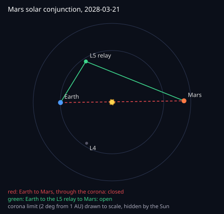
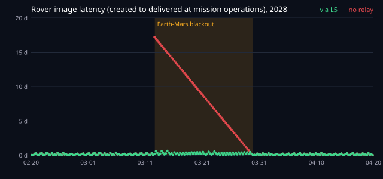

# Mars through solar conjunction, by way of Sun-Earth L5

Run 2026-10-22. Reproduce: `make ssi-conjunction` (`node ssi/conjunction/run.mjs --write`,
about 15 seconds). Fast checks: `test/conjunction.test.mjs`.

Every 26 months Mars passes behind the Sun as seen from Earth. Radio paths through the inner
corona fail, so for about two weeks missions stop sending commands and the spacecraft keep
their data until it is over. A relay at Sun-Earth L5, 60 degrees behind Earth on its orbit,
sees Mars far from the Sun the whole time. This asks what that relay would change, with the
geometry computed and the network real.

## The geometry

Planet positions come from Standish's Keplerian elements (`ssi/ephem.mjs`); L4 and L5 ride
Earth's orbit 60 degrees ahead and behind. A link is closed when its path passes closer to the
Sun than 1 AU x sin(2 deg), about 7.5 solar radii: from Earth that is the usual
Sun-Earth-probe angle limit, and the same physics applies to the L5-Mars path.

Checked against the last documented conjunction: NASA held commands to its Mars fleet from 11
to 25 November 2023; this model has Mars within 2 degrees of the Sun from 11 to 24 November
2023.

The next conjunction is on 21 March 2028:

| Sun limit | Earth-Mars blackout | Longest Mars-L5 gap |
|---|---|---|
| 1 deg | 5.6 days | 0.7 h |
| 2 deg (used below) | 17.1 days, 12 to 29 March | 0.7 h |
| 3 deg | 27.0 days | 0.7 h |
| 5 deg | 46.0 days | 0.7 h |

On 21 March, Mars is 0.8 degrees from the Sun seen from Earth and 35.5 degrees seen from L5,
2.08 AU away. The L5 relay's only gaps to Mars are the relay orbiter passing behind Mars.

## The network

Mission operations, the three deep-space stations (Goldstone, Madrid, Canberra), a Mars relay
orbiter, a rover, and in the second run a relay at L5 run by its own operator. Contacts are
computed from geometry every 2 minutes over 75 days (15 February to 1 May 2028); rates fall
with the square of the distance. Every node is a custodian: real BPv7 bundles, contact graph
routing at every hop, a signed receipt v2 per hop, in-band keys, and clearing between
operators from the receipts (`ssi/network.mjs`, `ssi/settle.mjs`).

Traffic for 60 days from 20 February: a 100 KB rover image to mission operations every 6
hours (240) and a 2 KB command to the rover every 12 hours (120).

| | No relay | With the L5 relay |
|---|---|---|
| Rover images delivered | 240 of 240 | 240 of 240 |
| Images made during the blackout (68): median / longest wait | 8.7 days / 17.0 days | 6.1 h / 14.9 h |
| Commands sent during the blackout (34): median / longest wait | 9.0 days / 17.0 days | 5.2 h / 14.1 h |
| Most data held on the Mars side | 6.9 MB, released 29 March | 0.3 MB |
| Bundles through the L5 relay | 0 | 67 images, 41 commands |
| Receipt chains verified at the destination | 360 of 360 | 360 of 360 |

Nothing is lost without the relay: custody holds everything until Mars comes back, which is
what DTN is for. What the relay removes is the wait, and the need to stop commanding: a
command sent during the blackout reached the rover within 14 hours instead of up to 17 days.

## Who gets paid

Clearing at the end of the period, from the receipts in delivered bundles, at illustrative
rates per MB (`world.mjs`):

| Operator | Bundles | MB | Amount |
|---|---|---|---|
| Deep-space ground network | 240 | 24.0 | 12.00 |
| Mars relay operator | 133 | 13.3 | 106.40 |
| L5 relay operator | 67 | 6.7 | 80.40 |

Each operator's statement is signed and lists the Merkle root of the receipts it was paid for;
all verify, and no claim was rejected. The L5 operator is paid only for the bundles its own
signed receipts show it carried, which is the case for an independent operator to build a
relay at all.

## Why L5

ESA plans to put its Vigil space-weather mission at Sun-Earth L5, with launch planned for 2031.
A spacecraft there with a deep-space radio and a DTN custodian could do this as a secondary
role. L4 works the same way geometrically (35.4 degrees from the Sun to Mars on conjunction
day); this run uses L5 only.

## Limits

- Simulated: positions from analytic orbits (good to well under a degree for this), rates
  illustrative, scaled with distance only; no link budget, pointing or scheduling conflicts.
- One relay at L5, one orbiter, one rover; the L5 relay is assumed to reach Mars at up to
  4 Mbps at 1 AU (0.9 Mbps at 2.08 AU), which needs a large antenna.
- The 2 degree limit is a typical value; the table above shows the blackout at other limits.
  The relay's advantage holds at all of them.
- Amounts are in an abstract unit; no payment is made.
